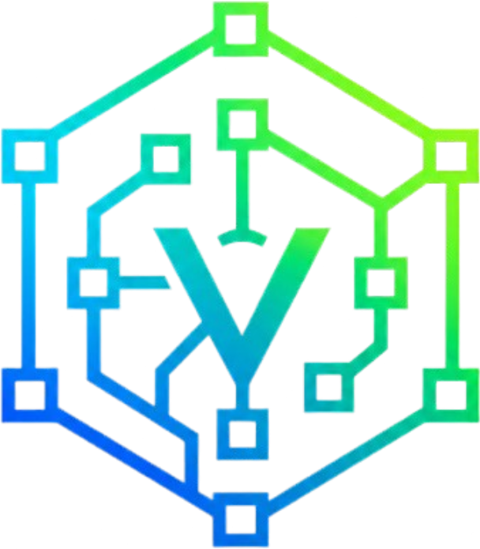

# Ricardo Vendramini Cassimiro

**Desenvolvedor Full-Stack · Fundador da Vendramini Informática · Game Dev indie**
📍 Piracicaba/SP — Brasil

---

## 👨‍💻 Sobre mim

Sou dono da **Vendramini Informática**, onde desenvolvo sistemas sob medida para negócios reais — imobiliárias, lojas, delivery, eventos — do banco de dados até a tela que o cliente usa. Nas horas vagas (e nem tão vagas assim), crio jogos.

- 🏢 **Sistemas para empresas** — CRMs, painéis administrativos, e-commerces e catálogos com **React + TypeScript + Supabase** (Auth, RLS, Realtime, Storage).
- ⚡ **Front-end leve e rápido** — muito HTML/CSS/JS puro, PWAs com modo offline (`localStorage` fallback) e efeitos em **Canvas 2D**.
- 🤖 **Automação** — integrações com WhatsApp, bots de Slack e Discord, Jira e Zendesk.
- 🎮 **Game dev** — do Pygame (8-bit, sons sintetizados) ao **Oathbound**, meu jogo web com login, ranking e saves na nuvem.

### 🔭 Agora estou trabalhando em

- ⚔️ **Oathbound** — em *open beta* com comunidade no Discord e lançamento em PT / ES / EN
- 🕹️ **Portfólio jogável** — uma versão do meu portfólio onde você anda por um mundo e entra nos projetos como se fossem exposições

---

## 🌟 Projetos em destaque

<table>
<tr>
<td width="50%" valign="top">

### ⚔️ Oathbound
Jogo web gratuito em *open beta*: heróis com armas e passivas combináveis, ranking mundial, saves na nuvem e login com Discord.

`JavaScript` `Supabase` `Discord OAuth`

[🎮 Jogar](https://oathbunder.vercel.app/) · [📖 Wiki](https://wikioathbound.vercel.app) · [📦 Repo da Wiki](https://github.com/rik-404/wiki.oathbound)

</td>
<td width="50%" valign="top">

### 🏢 Elite House Hub
Plataforma imobiliária em produção: CRM, gestão de imóveis e clientes, financeiro, agenda e analytics.

`React 18` `TypeScript` `Vite` `Supabase` `Tailwind` `PWA`

[🌐 Ver site](https://elitehousepiracicaba.com.br) · 🔒 *código privado (cliente)*

</td>
</tr>
<tr>
<td width="50%" valign="top">

### 🚀 Portfólio interativo
Portfólio bilíngue (PT-BR / EN) com experiência gamificada, terminal estilo CLI e sistema de conquistas.

`React 18` `Vite` `Tailwind` `Framer Motion` `Canvas 2D`

[🌐 Ver site](https://www.ricardovendramini.site) · [📦 Repo](https://github.com/rik-404/Ricardo-Vendramini)

</td>
<td width="50%" valign="top">

### 🐞 Vendramini Slack Tools
Bot modular de chamados para Slack (`/ticket`, `/bug`, `/pix`…) com integração Jira e Zendesk e dashboard de métricas.

`Node.js` `Slack API` `Supabase` `React` `Tailwind`

[📦 Repo](https://github.com/rik-404/Vendramini-Slack-Tools)

</td>
</tr>
</table>

<b>📂 Mais projetos (clique para abrir)</b>

 

| Projeto | O que é | Stack | Links |
| :--- | :--- | :--- | :---: |
| ⚡ **Vendramini Informática** | Site institucional com efeito Matrix em Canvas e apresentação do CRM **VendraX** | `HTML` `CSS` `JS` `Canvas` `PWA` | [🌐](https://vendraminiinformatica.com.br/) |
| 🍔 **Sabor Express** | Cardápio digital e delivery com modo local ou nuvem (Supabase + RLS) | `JS` `Supabase` | [🌐](https://rik-404.github.io/menu-de-delivery/) · [📦](https://github.com/rik-404/menu-de-delivery) |
| 📱 **CP CELL** | Loja virtual de eletrônicos com painel administrativo | `JS` `Supabase` `Vercel` | [🌐](https://rik-404.github.io/cpcell/) · [📦](https://github.com/rik-404/cpcell) |
| 💖 **Festa Fácil** | Catálogo de orçamentos com busca em tempo real e envio direto para o WhatsApp | `JS` `Supabase` | [🌐](https://rik-404.github.io/Festa-Facil/) · [📦](https://github.com/rik-404/Festa-Facil) |
| ✅ **TaskFlow** | To-do list com CRUD, sub-tarefas, filtros e tema claro/escuro | `HTML` `CSS` `JS` | [🌐](https://rik-404.github.io/Task-FLOW/) · [📦](https://github.com/rik-404/Task-FLOW) |
| 🎮 **Rei das Roms** | Catálogo de retrogames, consoles e emuladores | `HTML` `CSS` `JS` | [🌐](https://rik-404.github.io/reisdasroms/) · [📦](https://github.com/rik-404/reisdasroms) |
| 🪄 **Fundo Mágico** | Gera fundos CSS a partir de uma descrição em texto | `HTML` `CSS` `JS` | [📦](https://github.com/rik-404/Fundo-Magico-) |
| 👽 **Retorno dos Aliens** | Shooter arcade retrô com máquina de estados e sons 8-bit sintetizados | `Python` `Pygame` | [📦](https://github.com/rik-404/Retorno-dos-Aliens) |
| 🔮 **Cigana Morgana** | Landing page mística com céu estrelado interativo em Canvas | `HTML` `CSS` `Canvas` | 🔒 cliente |
| 🛍️ **Catatau Eletrônicos** | E-commerce de eletrônicos com painel admin | `JS` `Supabase` | 🔒 cliente |

---

## 🛠️ Stack

---

## 📊 GitHub

---

## 📬 Contato

Precisa de um site, sistema ou automação para o seu negócio? Fala comigo:

[_98231--6964-25D366?style=for-the-badge&logo=whatsapp&logoColor=white)](https://wa.me/5519982316964)

© 2026 Ricardo Vendramini Cassimiro · Vendramini Informática

